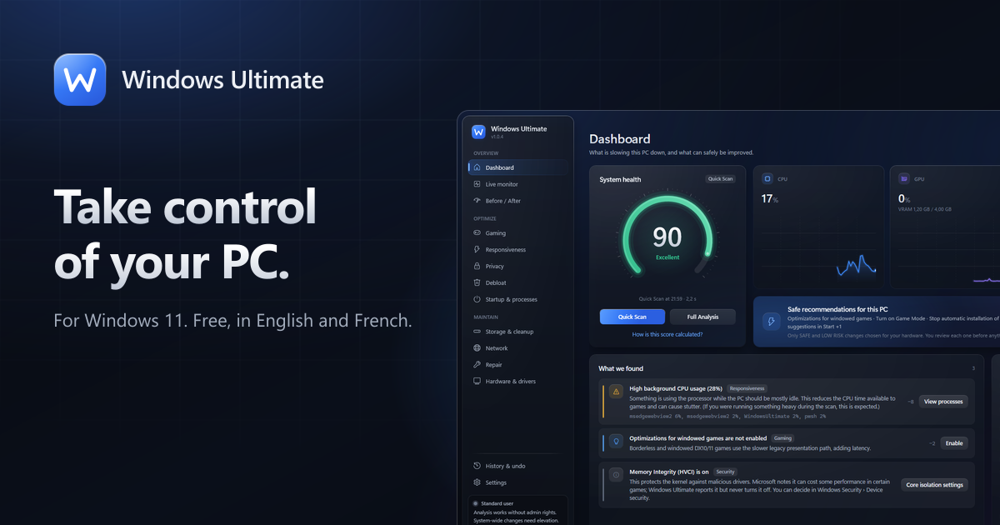
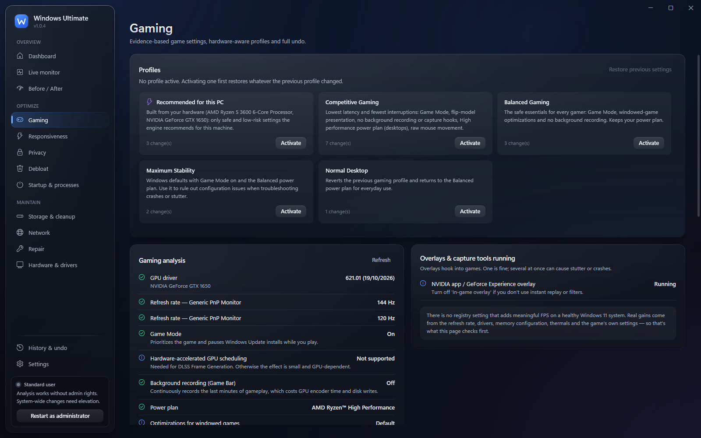
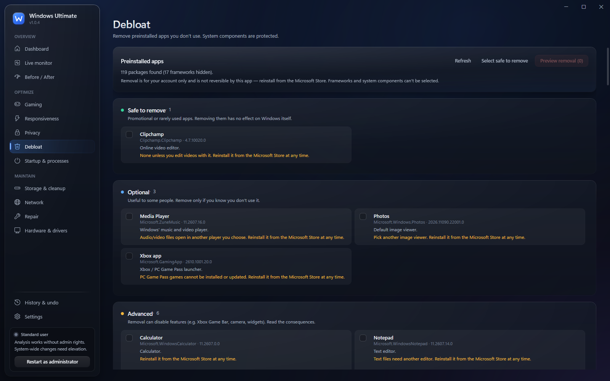
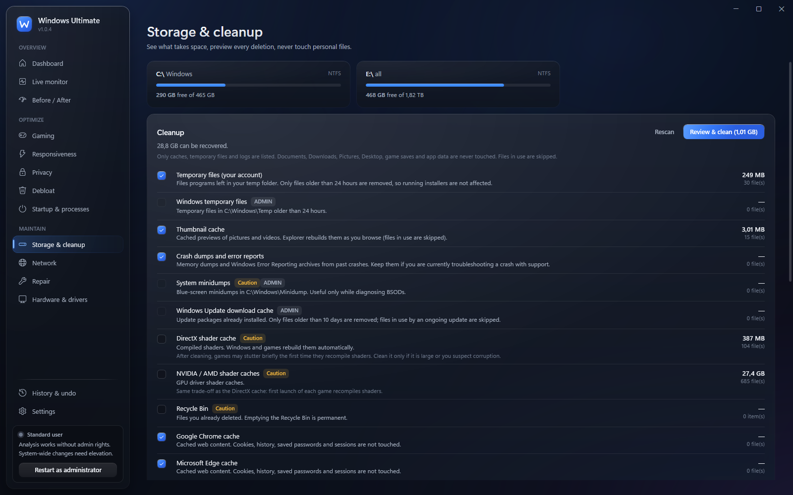
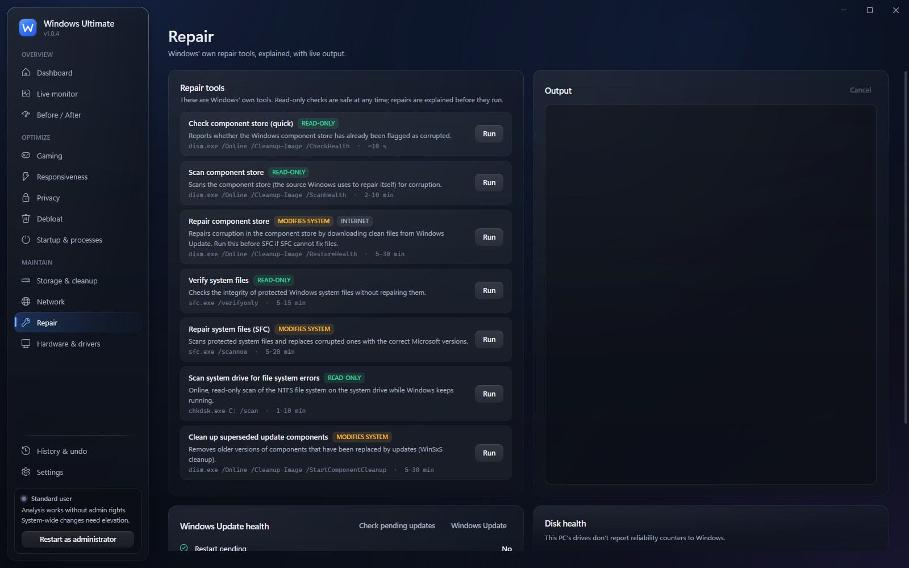

<div align="center">


# Windows Ultimate

**Find out what is really slowing your PC down, and fix it without breaking Windows.**

[](https://github.com/lololyeye/WindowsUltimate/releases/latest)
[](https://github.com/lololyeye/WindowsUltimate/releases)
[-0a0f1a?style=flat-square&logo=windows)](#-requirements)
[](#%EF%B8%8F-for-developers)

[**⬇ Download for Windows**](https://github.com/lololyeye/WindowsUltimate/releases/latest) · [Website](https://lololyeye.github.io/WindowsUltimate/)

<br />



</div>

<br />

Windows Ultimate is a free Windows 11 app that **scans your PC, explains what is slowing it down, and applies only documented, reversible changes** after you have reviewed them. Every setting it can change says what it does, why it helps, what it costs and how to undo it.

> **Nothing changes without your consent.** The scan runs as a standard user and only reads.
> Before any change, the original value is saved, so you can undo it later, even after a crash or a restart.

<br />

## ✨ Why Windows Ultimate

|  |  |
|---|---|
| 🔍 **It measures first** | A Quick Scan or a Full Analysis (event logs, drivers, disk health) gives a health score with its method shown, and each finding says how much it counts. |
| ↩️ **Everything can be undone** | Each change is written to a journal before it is applied, then checked. Undo one change, a session, or everything. What cannot be undone (removing an app, emptying a cache) is labelled as such. |
| 🛡️ **Security stays on** | No setting touches Defender, the Firewall, UAC, SmartScreen, Memory Integrity (VBS/HVCI) or Windows Update. A unit test checks the catalog for it. |
| 🧾 **No placebo tweaks** | Timer resolution, HPET, Nagle, RAM cleaners, core parking, disabling SysMain or Spectre mitigations… are not applied. The app explains why each one doesn't help on Windows 11. |

<br />

## 🖼️ A look inside

<table>
  <tr>
    <td align="center"><br /><sub><b>Gaming</b>: analysis, overlays and profiles</sub></td>
    <td align="center"><br /><sub><b>Debloat</b>: every app classified, system packages locked</sub></td>
  </tr>
  <tr>
    <td align="center"><br /><sub><b>Storage</b>: cleanup with size and file count first</sub></td>
    <td align="center"><br /><sub><b>Repair</b>: DISM, SFC and chkdsk, explained</sub></td>
  </tr>
</table>

All screenshots are real captures of the app. The [website](https://lololyeye.github.io/WindowsUltimate/) also walks through a sample optimization session, step by step.

<br />

## 🚀 Get started in 3 steps

1. **Download** `WindowsUltimate-<version>-setup.exe` from the [latest release](https://github.com/lololyeye/WindowsUltimate/releases/latest) and run it.
   The installer asks for admin rights once to install. The app itself then runs as a standard user.
2. **Open Windows Ultimate** and click **Quick Scan** on the dashboard (or **Full Analysis** for event logs, drivers and disk health).
3. **Read what it found**, pick the recommendations you want, review them, and apply. Everything lands in **History & undo**.

> [!NOTE]
> The installer is not code-signed yet, so Windows SmartScreen may say *"Windows protected your PC"*.
> Click **More info**, then **Run anyway**. Each release publishes the installer's SHA-256 so you can check it.

Installed copies **update themselves**: when a new version is out, the app shows the version, size and notes, and you choose whether to install it. The download comes from this repository's GitHub releases and its SHA-256 is checked before it runs.

<br />

## 🎨 What it can do

| Page | What it does |
|---|---|
| 📊 **Dashboard** | Hardware summary, live CPU/GPU/RAM, health score with its method and per-finding penalties, Quick Scan / Full Analysis, one-click *safe* recommendations (still reviewed). |
| 📈 **Live monitor** | CPU, GPU, RAM, disk, network, temperatures, top processes. Sampling only runs while the page is visible, at the interval you set. |
| ⚖️ **Before / After** | A synthetic benchmark (idle CPU, single and multi-core CPU, memory bandwidth, disk, thread wake latency) with noise thresholds, history and comparison. |
| 🎮 **Gaming** | Driver age, refresh rate vs. max, Game Mode, HAGS, background recording, dual-channel, XMP, overlay detection, and profiles (Smart, Competitive, Balanced, Max stability, Normal desktop) with "restore previous". |
| ⚡ **Responsiveness** | Measured causes of lag, a symptom → cause guide, evidence-based settings, and the common myths explained. |
| 🔒 **Privacy** | Reversible privacy settings, plus a review of app permissions that links to Windows Settings. |
| 🧹 **Debloat** | Apps classified *Safe*, *Optional*, *Advanced* or *Do not remove*. Frameworks and system packages are locked. Preview and double confirmation. |
| 🚦 **Startup & processes** | Startup entries (with Task Manager's own enable/disable mechanism), third-party scheduled tasks, and processes (only third-party ones can be ended, after a confirmation). |
| 💾 **Storage & cleanup** | Drives, cleanup with a preview, largest folders, large files, a duplicate finder (by content), installed programs. |
| 🌐 **Network** | Router vs. internet latency, jitter and loss with a diagnosis, Wi-Fi signal and band advice, a DNS comparison (DNS does not change game ping, and it says so), flush DNS, network reset. |
| 🔧 **Repair** | DISM, SFC and chkdsk `/scan` with live output, Windows Update services, pending updates, disk reliability counters, event-log problems. |
| 🖥️ **Hardware & drivers** | Components, driver versions and ages, problem devices with their Device Manager codes, official driver sources. |
| 🕓 **History & undo** | Every session and change with old → new values. Undo a change, a session or everything. Export as a zip. Restore points as an extra safety net. |
| ⚙️ **Settings** | Language (follows Windows; English or French), restore-point default, data folder, the principles and the score method. |

### Recommendations that fit your PC

Every setting in the catalog has the exact value it changes, why it helps, the expected impact, its drawbacks, whether a restart is needed, how to undo it, a risk level and a source. Recommendations depend on the hardware the scan detects: hardware GPU scheduling is only suggested on GPUs where it matters, and the High performance power plan is not suggested on laptops, X3D CPUs or hybrid Intel CPUs.

<br />

## 🔐 Safety rules, enforced in code

- **One path for every change.** Everything goes through the same consent dialog and engine. Moderate-risk changes need an explicit acknowledgement; destructive ones (removing an app, resetting the network, "undo all") need a second confirmation.
- **Journal, apply, verify.** The original value is written to `%LOCALAPPDATA%\WindowsUltimate\journal` first, then the change is applied and read back. If it fails, that change is rolled back.
- **No remote code.** No script is downloaded or run. The only download is the app's own update, after you accept it. Drivers and firmware are never downloaded or flashed: the app links to the vendor's page and Windows Update.
- **Your files are never deleted automatically.** Cleanup only targets caches, temp files and logs, and skips files in use. Large files and duplicates can only go to the Recycle Bin, one at a time, and the last copy of a duplicate is protected.
- **Insider builds are respected.** Telemetry changes are refused there, since they would break flighting. The privacy page never edits the hosts file or the firewall.

<br />

## 💻 Requirements

| | |
|---|---|
| **System** | Windows 11 (build 22000 or later), 64-bit |
| **Rights** | admin to install; the app runs as a standard user, and system-wide changes need it to be restarted elevated |
| **Download** | about 45 MB (self-contained, nothing else to install) |
| **Languages** | English and French |

<br />

## ❓ FAQ & troubleshooting

<details>
<summary><b>Windows says "Windows protected your PC"</b></summary>

The installer is not code-signed yet. Click **More info**, then **Run anyway**. You can compare the installer's SHA-256 with the `.sha256` file published on the release page.
</details>

<details>
<summary><b>Some settings are greyed out</b></summary>

System-wide changes need admin rights, and the app starts as a standard user on purpose. Restart it elevated when you want to apply them. The scan itself never needs it.
</details>

<details>
<summary><b>Will it make my games run faster?</b></summary>

It finds what is actually holding the PC back (background load, outdated drivers, a monitor running below its refresh rate, single-channel memory…) and fixes what can safely be fixed. It does not promise an FPS gain. The *Before / After* benchmark is there to confirm a change didn't make things worse, not to measure game FPS.
</details>

<details>
<summary><b>The CPU temperature looks wrong or is missing</b></summary>

It is the ACPI thermal zone reported by the firmware. On many desktops that is not the core temperature, or it isn't reported at all. GPU temperature comes from NVML, so it is shown on NVIDIA cards only.
</details>

<details>
<summary><b>Creating a restore point failed</b></summary>

By default Windows allows one restore point every 24 hours, and the app tells you when that is the reason. Restore points are an extra layer: the journal is what undo relies on.
</details>

<details>
<summary><b>How is "startup impact" measured?</b></summary>

It is estimated from the memory the running process uses, not from boot tracing.
</details>

<details>
<summary><b>How do I uninstall and revert everything?</b></summary>

Run **History & undo → Undo all** first, then uninstall from Windows Settings. Uninstalling keeps `%LOCALAPPDATA%\WindowsUltimate` (journal, logs, settings); delete that folder if you don't need it anymore.
</details>

<details>
<summary><b>Something else went wrong</b></summary>

[Open an issue](https://github.com/lololyeye/WindowsUltimate/issues) with what you did, what you expected and your Windows version. You can attach an export from *History & undo*.
</details>

<br />

## 🛠️ For developers

Windows Ultimate is written in **C#** on **.NET 10** with **WPF**. The engine has no UI dependency and is covered by tests that run sandboxed in `HKCU`.

<details>
<summary><b>Build from source</b></summary>

Requirements: Windows 11, the .NET 10 SDK, and Inno Setup 6 for the installer.

```bash
dotnet build WindowsUltimate.sln
```

```bash
dotnet test WindowsUltimate.sln
```

```bash
dotnet run --project src/WindowsUltimate.App
```

To build the installer, publish a self-contained build, then compile the Inno Setup script:

```bash
dotnet publish src/WindowsUltimate.App -c Release -r win-x64 --self-contained true -o publish/win-x64
```

```bash
iscc installer/WindowsUltimate.iss
```
</details>

<details>
<summary><b>How it fits together</b></summary>

```
WPF views  (Dashboard · Monitor · Before/After · Gaming · … · History · Settings)
   ↓  view models
Services/TweakApplier.cs      the only UI path that changes the system (consent dialog)
   ↓
Optimization/OptimizationEngine.cs   journal → apply → verify → rollback on failure
   ├─ Actions.cs        registry, power plan and scheduled-task actions (capture / restore)
   └─ TweakCatalog.cs   every setting and its documentation
Diagnostics/SystemAnalyzer.cs        scan and health score
```

| Folder | What's inside |
|---|---|
| `src/WindowsUltimate.Core/` | engine, journal, catalog, diagnostics, monitoring, services (no UI) |
| `src/WindowsUltimate.App/` | WPF shell, design system (`Theme/Tokens.xaml`, `Theme/Controls.xaml`), view models, views, EN/FR strings |
| `tests/WindowsUltimate.Tests/` | engine, journal and rollback tests (sandboxed in `HKCU`), catalog safety tests |
| `installer/` | Inno Setup script |
| `website/` | the [website](https://lololyeye.github.io/WindowsUltimate/) (Astro) |

**Design system.** `Theme/Tokens.xaml` defines the materials, light, shadows, typography and motion (180–300 ms ease-out), and `Controls/Fx.cs` adds hover, entrances and loading skeletons. On Windows 11 22H2+ with transparency on, the window uses the native acrylic backdrop; otherwise it falls back to an opaque background. Nothing animates continuously, and live sampling pauses while the window is minimized.
</details>

<details>
<summary><b>Releases and updates</b></summary>

Every push to `master` runs [`.github/workflows/release.yml`](.github/workflows/release.yml): it runs the tests, publishes a self-contained build, compiles the installer and creates a GitHub Release `v1.0.<run number>` with the installer and its `.sha256`. The notes come from the commit messages. Changes to Markdown files and to `website/` don't trigger a release.

At startup (Release builds only, if *Settings → Check for updates at startup* is on), the app asks the GitHub API for the latest release. If you accept the update, the installer is downloaded from github.com, its SHA-256 is checked against the published one (a mismatch deletes it), then it runs silently: the app closes, updates in place and reopens. Settings, the journal and history are kept.
</details>

<br />

## 🙏 Built with

- **.NET 10** and **WPF**, with `System.Management`, `System.Diagnostics.EventLog` and `System.ServiceProcess.ServiceController`.
- **NVML** (NVIDIA) for GPU temperature, when it is available.
- **xUnit** for the tests, **Inno Setup 6** for the installer, **Astro** for the website.

<br />

<details>
<summary><b>🇫🇷 En français</b></summary>

<br />

**Windows Ultimate** est une application gratuite pour Windows 11 qui **analyse votre PC, explique ce qui le ralentit, et n'applique que des réglages documentés et réversibles**, après que vous les avez vérifiés. Rien ne change sans votre accord : l'analyse tourne en utilisateur standard et ne fait que lire.

- **Tout s'annule** : chaque modification est d'abord notée dans un journal, puis appliquée et vérifiée. Annulez un changement, une session ou tout, même après un plantage ou un redémarrage.
- **La sécurité reste en place** : aucun réglage ne touche Defender, le Pare-feu, l'UAC, SmartScreen, l'intégrité de la mémoire ou Windows Update.
- **Pas de faux réglages** : timer resolution, HPET, Nagle, nettoyeurs de RAM… ne sont pas appliqués, et l'application explique pourquoi.
- **14 pages** : tableau de bord, moniteur, avant/après, jeu, réactivité, confidentialité, applications préinstallées, démarrage, stockage, réseau, réparation, matériel et pilotes, historique, paramètres.

**Installation** : téléchargez `WindowsUltimate-<version>-setup.exe` depuis la [dernière version](https://github.com/lololyeye/WindowsUltimate/releases/latest) et lancez-le (droits admin demandés une fois pour l'installation). Si Windows affiche « Windows a protégé votre ordinateur », cliquez sur **Informations complémentaires** puis **Exécuter quand même** (l'installateur n'est pas encore signé). L'application est entièrement en français, et le [site](https://lololyeye.github.io/WindowsUltimate/fr/) aussi.

</details>

<br />

<div align="center">

<sub>Made by zero. Also by me: <a href="https://github.com/lololyeye/aoze">Aoze</a>, to make your images, GIFs and clips look better.</sub>

</div>
